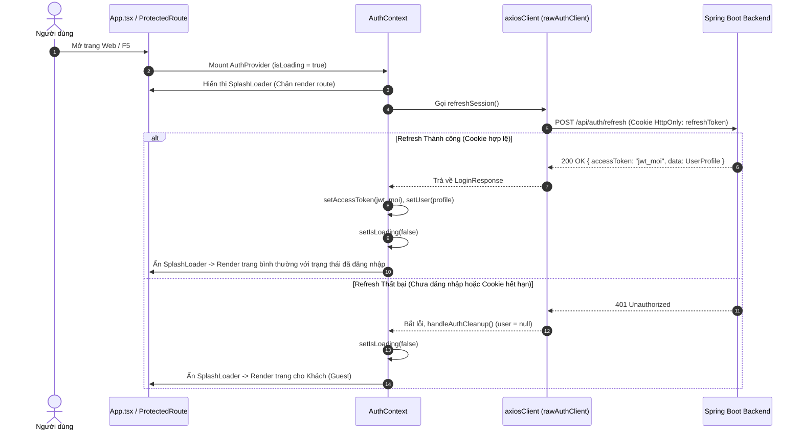
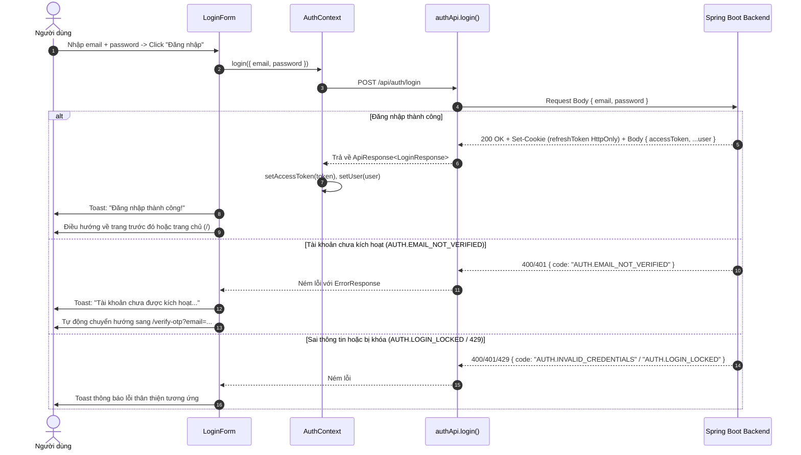
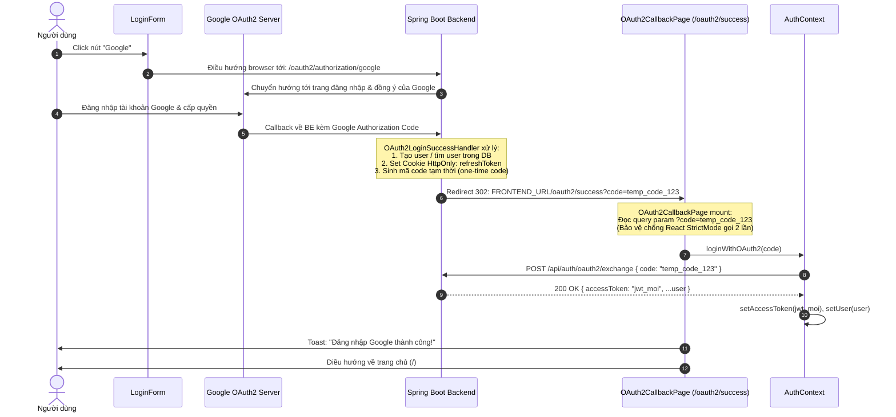
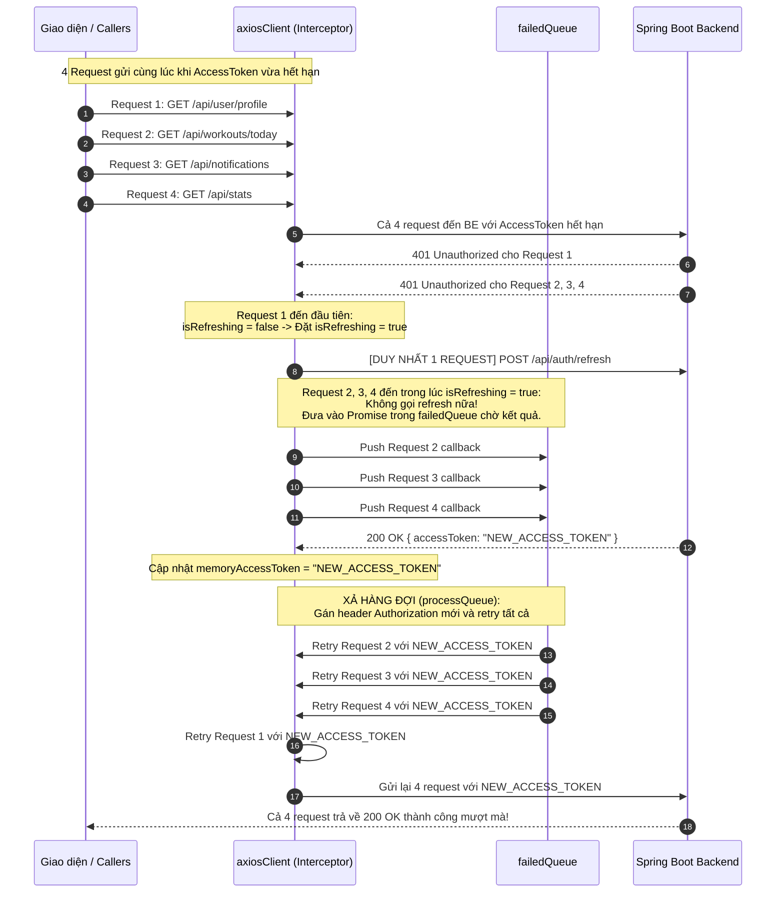
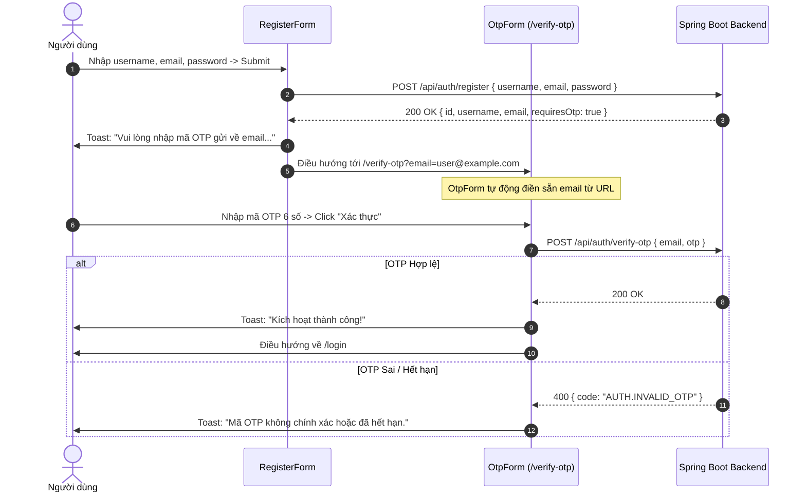

# TÀI LIỆU VẬN HÀNH KIẾN TRÚC & LUỒNG AUTHENTICATION (REACT + SPRING BOOT)

Tài liệu này giải thích chi tiết toàn bộ cơ chế, quy trình và luồng vận hành của hệ thống **Authentication & Authorization** chuẩn **Enterprise / Production-ready** tại Frontend (`zenfit-fe-router`) kết nối với Spring Boot Backend.

---

## MỤC LỤC
1. [Triết lý Bảo mật & Cơ chế Dual-Token](#1-triết-lý-bảo-mật--cơ-chế-dual-token)
2. [Cấu trúc Thư mục & Trách nhiệm từng Module](#2-cấu-trúc-thư-mục--trách-nhiệm-từng-module)
3. [Chi tiết Các Luồng Vận hành (Sequence Flows)](#3-chi-tiết-các-luồng-vận-hành-sequence-flows)
   - [Flow 1: Khởi động Ứng dụng & Silent Refresh (F5 / Mở tab mới)](#flow-1-khởi-động-ứng-dụng--silent-refresh-f5--mở-tab-mới)
   - [Flow 2: Đăng nhập Email & Password](#flow-2-đăng-nhập-email--password)
   - [Flow 3: Đăng nhập Google OAuth2 (Redirect Flow)](#flow-3-đăng-nhập-google-oauth2-redirect-flow)
   - [Flow 4: Cơ chế Mutex Queue xử lý Concurrency Refresh Token (Chống Race Condition)](#flow-4-cơ-chế-mutex-queue-xử-lý-concurrency-refresh-token-chống-race-condition)
   - [Flow 5: Đăng ký & Kích hoạt OTP](#flow-5-đăng-ký--kích-hoạt-otp)
   - [Flow 6: Quên Mật khẩu 3 Bước (Forgot Password Wizard)](#flow-6-quên-mật-khẩu-3-bước-forgot-password-wizard)
   - [Flow 7: Đổi mật khẩu trong Profile](#flow-7-đổi-mật-khẩu-trong-profile)
   - [Flow 8: Đăng xuất & Dọn dẹp Phiên (Logout)](#flow-8-đăng-xuất--dọn-dẹp-phiên-logout)
4. [Cơ chế Phân quyền Tuyến đường (RBAC Route Guards)](#4-cơ-chế-phân-quyền-tuyến-đường-rbac-route-guards)
5. [Cơ chế Bắt lỗi & Error Code Mapping](#5-cơ-chế-bắt-lỗi--error-code-mapping)
6. [Hướng dẫn Thiết lập & Kiểm thử (Testing Checklist)](#6-hướng-dẫn-thiết-lập--kiểm-thử-testing-checklist)

---

## 1. Triết lý Bảo mật & Cơ chế Dual-Token

Hệ thống tuân thủ tiêu chuẩn bảo mật nghiêm ngặt nhất cho Single Page Applications (SPA):

| Thành phần | Nơi lưu trữ | Cơ chế truyền nhận | Mục đích bảo mật |
| :--- | :--- | :--- | :--- |
| **`accessToken`** | **Bộ nhớ RAM (Memory / JS Variable)** | Request Header: `Authorization: Bearer <token>` | **Chống XSS hoàn toàn**: Kẻ tấn công inject mã độc qua JavaScript không thể đọc được token từ `localStorage` hay `sessionStorage`. Thời hạn sống ngắn (5 - 15 phút). |
| **`refreshToken`** | **HttpOnly Cookie** do Backend set (`SameSite=None`, `Secure=true`, `Path=/`) | Tự động gửi ngầm bởi Trình duyệt qua mọi request | **Chống rò rỉ token**: JavaScript tuyệt đối không thể đọc được Cookie này (`document.cookie` không thấy). Được bảo vệ bởi trình duyệt. |
| **Cấu hình Axios** | `withCredentials: true` | Bắt buộc trên toàn bộ Axios client | Cho phép trình duyệt gửi và nhận Cookie giữa 2 domain (ví dụ: FE port `5173` và BE port `8080`). |

---

## 2. Cấu trúc Thư mục & Trách nhiệm từng Module

```text
src/
├── shared/
│   ├── api/
│   │   └── axiosClient.ts              # Quản lý in-memory token, Request Interceptor,
│   │                                   # Mutex Refresh Queue Interceptor xử lý lỗi 401.
│   ├── components/
│   │   ├── guards/
│   │   │   ├── ProtectedRoute.tsx      # Chặn truy cập trái phép, kiểm tra quyền hạn Roles (RBAC).
│   │   │   └── PublicOnlyRoute.tsx     # Chặn user đã đăng nhập quay lại màn Login/Register.
│   │   └── ui/
│   │       └── SplashLoader.tsx        # Splash Screen hiển thị trong quá trình Silent Refresh.
│   └── utils/
│       └── authErrorHandler.ts         # Bắt mã code backend (AUTH.xxx) & map thông báo tiếng Việt.
├── features/
│   └── auth/
│       ├── types/
│       │   └── auth.types.ts           # DTOs chuẩn 100% với Spring Boot (ApiResponse, Req/Res).
│       ├── api/
│       │   └── auth.api.ts             # Gọi API tới các endpoints /api/auth/*.
│       ├── context/
│       │   └── AuthContext.tsx         # Quản lý React State (user, isLoading, isAuthenticated),
│       │                               # Chạy Silent Refresh khởi động App & kích hoạt actions.
│       ├── hooks/
│       │   └── useAuth.ts              # Hook tiện ích để lấy AuthContext tại các components.
│       ├── pages/
│       │   ├── LoginPage.tsx           # Trang đăng nhập.
│       │   ├── RegisterPage.tsx        # Trang đăng ký.
│       │   ├── VerifyOtpPage.tsx       # Trang xác thực OTP kích hoạt.
│       │   ├── ForgotPasswordPage.tsx  # Trang quên mật khẩu.
│       │   └── OAuth2CallbackPage.tsx  # Xử lý callback /oauth2/success?code=... từ Google.
│       └── components/
│           ├── LoginForm.tsx           # Form login + nút Google OAuth2 redirect.
│           ├── RegisterForm.tsx        # Form register hỗ trợ kiểm tra requiresOtp.
│           ├── OtpForm.tsx             # Form xác thực OTP với query param email.
│           ├── ForgotPasswordForm.tsx  # Wizard 3 bước: Nhập email -> OTP -> Reset Password.
│           └── ChangePasswordModal.tsx # Modal đổi mật khẩu khi đã đăng nhập.
```

---

## 3. Chi tiết Các Luồng Vận hành (Sequence Flows)

### Flow 1: Khởi động Ứng dụng & Silent Refresh (F5 / Mở tab mới)

Do `accessToken` được lưu trong bộ nhớ RAM, khi người dùng tải lại trang (F5) hoặc mở tab mới, token trong RAM sẽ biến mất (`null`). Thay vì bắt người dùng phải đăng nhập lại, Frontend tự động thực hiện **Silent Refresh**.



---

### Flow 2: Đăng nhập Email & Password



---

### Flow 3: Đăng nhập Google OAuth2 (Redirect Flow)

Backend sử dụng cơ chế bảo mật OAuth2 Redirect: BE trực tiếp tương tác với Google, bảo vệ `Client Secret` không bị lộ ở Frontend.



---

### Flow 4: Cơ chế Mutex Queue xử lý Concurrency Refresh Token (Chống Race Condition)

#### Vấn đề bài toán:
Giả sử người dùng mở trang Dashboard có **4 request API đồng thời**:
1. `GET /api/user/profile`
2. `GET /api/workouts/today`
3. `GET /api/notifications`
4. `GET /api/stats`

Tại thời điểm `accessToken` hết hạn, cả 4 request này sẽ **cùng lúc nhận mã lỗi 401 Unauthorized** từ Backend. Nếu không có cơ chế Mutex:
- Frontend sẽ spam **4 request `POST /api/auth/refresh`** cùng lúc.
- Backend áp dụng cơ chế xoay tua Token (Refresh Token Rotation) sẽ phát hiện nhiều request dùng cùng refresh token -> nghi ngờ bị tấn công và **thu hồi toàn bộ phiên**, dẫn đến người dùng bị logout đột ngột!

#### Giải pháp tại `axiosClient.ts`:
Dùng biến cờ `isRefreshing` và mảng callback `failedQueue`.



---

### Flow 5: Đăng ký & Kích hoạt OTP



---

### Flow 6: Quên Mật khẩu 3 Bước (Forgot Password Wizard)

Triển khai dưới dạng State Machine mượt mà trong [ForgotPasswordForm.tsx](file:///d:/TTCN/Zenfit/client/zenfit-fe-router/src/features/auth/components/ForgotPasswordForm.tsx):

```text
[BƯỚC 1: NHẬP EMAIL]
  │
  ├──> POST /api/auth/forgot-password { email }
  │    └── BE tạo mã OTP và gửi về email
  ▼
[BƯỚC 2: NHẬP MÃ OTP]
  │
  ├──> POST /api/auth/verify-forgot-password-otp { email, otp }
  │    └── BE xác thực OTP và trả về { resetToken: "uuid-hoac-jwt" }
  ▼
[BƯỚC 3: ĐẶT MẬT KHẨU MỚI]
  │
  ├──> POST /api/auth/reset-password { email, resetToken, newPassword }
  │    └── BE cập nhật mật khẩu mới & thu hồi resetToken
  ▼
[HOÀN TẤT & ĐIỀU HƯỚNG VỀ /login]
```

---

### Flow 7: Đổi mật khẩu trong Profile

Dành cho người dùng đã đăng nhập:
1. Người dùng mở `ChangePasswordModal`.
2. Nhập `currentPassword`, `newPassword`, `confirmPassword`.
3. Gửi `POST /api/auth/change-password` kèm Header `Authorization: Bearer <accessToken>`.
4. Nếu đúng mật khẩu hiện tại: Backend cập nhật thành công và thông báo Toast xanh.

---

### Flow 8: Đăng xuất & Dọn dẹp Phiên (Logout)

1. Người dùng bấm **"Đăng xuất"** trên Header.
2. Frontend gọi `POST /api/auth/logout`.
3. Backend:
   - Trích xuất `accessToken` từ Header và lưu vào **Redis Blacklist** (với TTL bằng thời gian sống còn lại của token).
   - Xóa Cookie `refreshToken` (set `Max-Age=0`).
4. Frontend:
   - Dù API có lỗi kết nối hay không, hàm `handleAuthCleanup()` luôn dọn sạch:
     - `setAccessToken(null)` (xóa token trong RAM).
     - `setUser(null)` (xóa state user).
   - Điều hướng về `/login`.

---

## 4. Cơ chế Phân quyền Tuyến đường (RBAC Route Guards)

### 1. `PublicOnlyRoute`
- **Mục đích**: Chặn người dùng đã đăng nhập vào lại các trang khách như `/login`, `/register`, `/forgot-password`, `/verify-otp`.
- **Hành vi**: Nếu `isAuthenticated === true`, tự động chuyển hướng về trang trước đó (`location.state.from`) hoặc trang chủ (`/`).

### 2. `ProtectedRoute`
- **Mục đích**: Bảo vệ các trang yêu cầu quyền hạn người dùng hoặc quản trị viên (Admin/Staff).
- **Hành vi**:
  1. Khi đang khởi động (`isLoading === true`): Render `<SplashLoader />`.
  2. Nếu chưa đăng nhập: Redirect về `/login`, đồng thời lưu URL hiện tại vào `state: { from: location }` để sau khi login xong có thể tự động quay lại đúng trang đó.
  3. Nếu có ràng buộc vai trò (`allowedRoles={['ADMIN', 'STAFF']}` hoặc `['ROLE_ADMIN', 'ROLE_STAFF']`):
     - Hàm `normalizeRole` tự động chuẩn hóa tiền tố `ROLE_`.
     - Kiểm tra xem trong `user.roles` có chứa ít nhất 1 role yêu cầu không.
     - Nếu **không đủ quyền**: Chuyển hướng sang màn hình [ForbiddenPage.tsx](file:///d:/TTCN/Zenfit/client/zenfit-fe-router/src/pages/ForbiddenPage.tsx) (`/403`).

---

## 5. Cơ chế Bắt lỗi & Error Code Mapping

Tất cả các lỗi trả về từ Backend qua `ErrorResponse` được chuẩn hóa tại [authErrorHandler.ts](file:///d:/TTCN/Zenfit/client/zenfit-fe-router/src/shared/utils/authErrorHandler.ts):

| Mã lỗi Backend (`code`) | Thông báo hiển thị trên Frontend | Hành động đặc biệt của Frontend |
| :--- | :--- | :--- |
| `AUTH.INVALID_CREDENTIALS` | *"Email hoặc mật khẩu không chính xác."* | Giữ nguyên form để nhập lại |
| `AUTH.USER_NOT_ACTIVE` / `AUTH.EMAIL_NOT_VERIFIED` | *"Tài khoản chưa được kích hoạt. Vui lòng xác thực mã OTP gửi về email."* | **Tự động chuyển hướng** sang `/verify-otp?email={email}` |
| `AUTH.LOGIN_LOCKED` | *"Tài khoản tạm thời bị khóa do sai quá 5 lần. Thử lại sau 5 phút."* | Khóa nút submit / cảnh báo thời gian |
| `AUTH.RATE_LIMIT_EXCEEDED` | *"Bạn thao tác quá nhanh. Vui lòng thử lại sau giây lát."* | Hiển thị thông báo Rate limit |
| `AUTH.INVALID_OTP` | *"Mã OTP không chính xác hoặc đã hết hạn."* | Cho phép nhập lại OTP |
| `AUTH.GOOGLE_ACCOUNT_LOGIN_REQUIRED` | *"Tài khoản được tạo bằng Google, vui lòng chọn Đăng nhập bằng Google."* | Hướng dẫn đăng nhập bằng nút Google |

---

## 6. Hướng dẫn Thiết lập & Kiểm thử (Testing Checklist)

### 1. File môi trường `.env`
Đảm bảo file `.env` tại thư mục gốc FE có cấu hình URL trỏ đến Spring Boot:
```env
VITE_API_BASE_URL=http://localhost:8080
```

### 2. Cấu hình CORS tại Spring Boot Backend (Rất quan trọng)
Vì Frontend sử dụng `withCredentials: true`, Backend Spring Boot **bắt buộc** phải cấu hình CORS:
- `allowCredentials = true`
- `allowedOrigins = ["http://localhost:5173"]` (KHÔNG được để dấu `*`)
- `allowedHeaders = ["*"]`
- `allowedMethods = ["GET", "POST", "PUT", "DELETE", "OPTIONS"]`

### 3. Checklist Kiểm thử
- [x] **Silent Refresh**: Đăng nhập thành công -> F5 trang -> Kiểm tra Network tab xem request `/api/auth/refresh` có được gọi và App vẫn giữ nguyên trạng thái đã đăng nhập không.
- [x] **Race Condition Concurrency**: Khi access token hết hạn, mở nhiều tab hoặc trigger nhiều API cùng lúc -> Xem Network tab chỉ có đúng 1 request `/api/auth/refresh`, sau đó các API khác tự động retry thành công.
- [x] **Google OAuth2**: Bấm nút Google -> Sang trang Google -> Nhận callback `/oauth2/success?code=...` -> Trở về trang chủ với thông báo thành công.
- [x] **Kích hoạt OTP**: Đăng ký -> Tự động chuyển `/verify-otp` -> Nhập OTP -> Kích hoạt tài khoản.
- [x] **Quên mật khẩu**: Hoàn thành đủ 3 bước (Email -> OTP -> Mật khẩu mới).
- [x] **Bảo vệ Route RBAC**: Đăng nhập tài khoản thường (User) -> Thử vào `/admin` -> Nhận trang 403 Forbidden.
