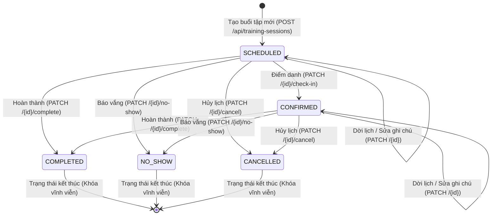

# Data Model & State Transitions: PT Training Sessions & Calendar

**Feature**: `001-pt-training-sessions`  
**Date**: 2026-11-03  
**Status**: Completed  

---

## 1. Conceptual Data Entities

### 1.1 TrainingSession (Buổi tập)
Represents a scheduled training appointment between a Personal Trainer and a Client, associated with an active contract.

| Field | Type | Required | Description | Validation / Constraints |
|:---|:---|:---:|:---|:---|
| `id` | `string` (UUID) | Yes | Unique session identifier | Read-only generated by server |
| `clientId` | `string` (UUID) | Yes | ID of the client / học viên | Must reference an existing client |
| `trainerId` | `string` (UUID) | Yes | ID of the personal trainer | Automatically assigned or admin-selected |
| `contractId` | `string` (UUID) | Yes | Associated PT contract ID | Must reference an `ACTIVE` contract with remaining sessions > 0 |
| `sessionName` | `string` | Yes | Title/objective of the workout | 1 - 255 chars (e.g., "Ngực & Tay sau", "Cardio") |
| `trainingDate` | `string` | Yes | Scheduled date of workout | ISO format `YYYY-MM-DD` |
| `startTime` | `string` | Yes | Scheduled start time | Format `HH:mm:ss` (e.g., "09:00:00") |
| `status` | `TrainingSessionStatus` | Yes | Current lifecycle status | Enum: `SCHEDULED`, `CONFIRMED`, `COMPLETED`, `CANCELLED`, `NO_SHOW` |
| `checkInAt` | `string \| null` | No | Server timestamp of attendance check-in | ISO-8601 datetime format (populated on check-in) |
| `completedAt` | `string \| null` | No | Server timestamp of workout completion | ISO-8601 datetime format (populated on completion) |
| `note` | `string \| null` | No | Workout notes, homework, diet instructions | Max 1000 characters |
| `createdAt` | `string` | No | Creation timestamp | Read-only ISO-8601 datetime |
| `updatedAt` | `string` | No | Last update timestamp | Read-only ISO-8601 datetime |

---

### 1.2 TrainingSessionCalendarItem (Phần tử hiển thị trên Lịch)
Optimized representation returned by the Calendar API endpoint (`GET /api/training-sessions/calendar`).

| Field | Type | Description |
|:---|:---|:---|
| `id` | `string` | Session ID |
| `clientId` | `string` | Client identifier |
| `trainerId` | `string` | Trainer identifier |
| `contractId` | `string` | Contract identifier |
| `sessionName` | `string` | Workout name |
| `trainingDate` | `string` | `YYYY-MM-DD` |
| `startTime` | `string` | `HH:mm:ss` |
| `status` | `TrainingSessionStatus` | Current status |
| `note` | `string \| null` | Optional session notes |

---

### 1.3 TrainingSessionCalendarResponse (Tổng thể dữ liệu Lịch)
Envelope returned by the calendar query.

| Field | Type | Description |
|:---|:---|:---|
| `view` | `CalendarViewType` | `DAY`, `WEEK`, or `MONTH` |
| `startDate` | `string` | Lower boundary date `YYYY-MM-DD` |
| `endDate` | `string` | Upper boundary date `YYYY-MM-DD` |
| `totalSessions` | `number` | Total number of sessions in interval |
| `sessions` | `TrainingSessionCalendarItem[]` | Chronologically sorted sessions |

---

## 2. Enums & Status Metadata

```typescript
export type TrainingSessionStatus =
  | 'SCHEDULED'   // Đã lên lịch, chưa diễn ra
  | 'CONFIRMED'   // Đã xác nhận / Đã check-in điểm danh
  | 'COMPLETED'   // Đã hoàn thành buổi tập
  | 'CANCELLED'   // Đã hủy lịch hẹn
  | 'NO_SHOW';    // Học viên vắng mặt

export type CalendarViewType = 'DAY' | 'WEEK' | 'MONTH';
```

### Visual & Label Mapping
| Status | Label | Badge Styling (Tailwind) | Allowed Actions |
|:---|:---|:---|:---|
| `SCHEDULED` | Đã lên lịch | `bg-blue-50 text-blue-700 border-blue-200 dark:bg-blue-950/40 dark:text-blue-300 dark:border-blue-800` | Check-in, Hoàn thành, Báo vắng, Hủy, Sửa ngày/giờ |
| `CONFIRMED` | Đã check-in | `bg-cyan-50 text-cyan-700 border-cyan-200 dark:bg-cyan-950/40 dark:text-cyan-300 dark:border-cyan-800` | Hoàn thành, Báo vắng, Hủy, Sửa ngày/giờ |
| `COMPLETED` | Hoàn thành | `bg-emerald-50 text-emerald-700 border-emerald-200 dark:bg-emerald-950/40 dark:text-emerald-300 dark:border-emerald-800` | Xem chi tiết (Khóa thao tác) |
| `NO_SHOW` | Vắng mặt | `bg-amber-50 text-amber-700 border-amber-200 dark:bg-amber-950/40 dark:text-amber-300 dark:border-amber-800` | Xem chi tiết (Khóa thao tác) |
| `CANCELLED` | Đã hủy | `bg-slate-100 text-slate-500 line-through border-slate-200 dark:bg-slate-800 dark:text-slate-400 dark:border-slate-700` | Xem chi tiết (Khóa thao tác) |

---

## 3. State Transitions & Lifecycle Rules



### Business Validation Rules
1. **Double Booking Prevention**:
   - `trainingDate` + `startTime` combination must be unique per `trainerId` (trainer cannot train two clients simultaneously).
   - `trainingDate` + `startTime` combination must be unique per `clientId` (client cannot have two simultaneous training appointments).
   - If collision is detected $\rightarrow$ Backend returns `409 Conflict`.
2. **Contract Validity Rule**:
   - The contract selected must have `status === 'ACTIVE'`.
   - The contract must have remaining sessions $> 0$ (`remainingSessions = totalSessions + bonusSessions - usedSessions`).
3. **Immutability of Terminal States**:
   - When status is `COMPLETED`, `CANCELLED`, or `NO_SHOW`, all subsequent `PATCH` requests to change date, time, or status must be prevented on client and rejected on server.

